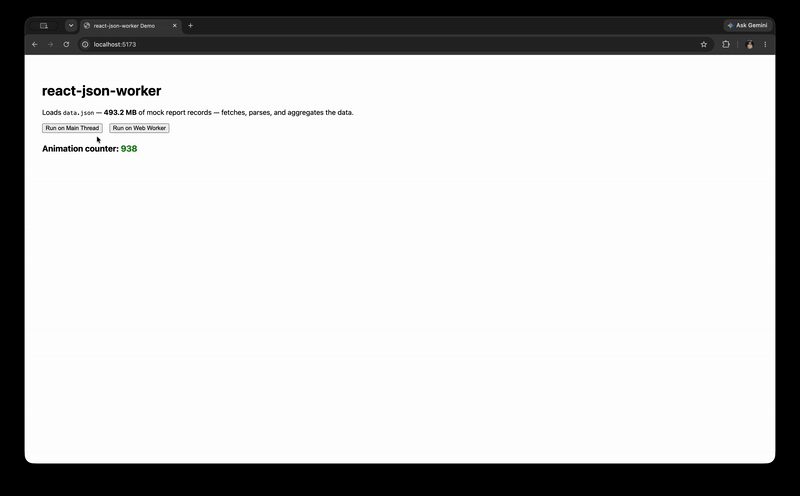

# react-json-worker

[](https://www.npmjs.com/package/react-json-worker)
[](LICENSE)
[](https://github.com/fdamianenriquez/react-json-worker/actions/workflows/ci.yml)

> Offload large-scale JSON processing to a Web Worker — keep your UI thread responsive.

---

## The problem

Processing large JSON payloads (tens or hundreds of thousands of records) on the main thread blocks the UI. Scrolling stutters, clicks lag, the app feels frozen. `JSON.parse`, filtering, aggregation — any synchronous computation over a big dataset starves the event loop.

## The solution

`useJSONWorker` is a React hook that moves JSON processing into a dedicated Web Worker. The worker runs in a separate thread, so the UI stays smooth. The API is minimal:

```ts
const { run, loading, error, terminate } = useJSONWorker(
  () => new Worker(new URL('./myWorker.ts', import.meta.url), { type: 'module' })
);
```

Call `run(data)` → get back a `Promise<TOutput>`. That's it.

**Real-world context:** This pattern was used in production to improve throughput by ~80% in an internal tool that processes large JSON reports (credit history, vehicle history, etc.). The main thread went from being blocked for seconds to staying fully responsive.

---

## Installation

```sh
npm install react-json-worker
```

> **Note:** `react >= 18` is a peer dependency.

---

## Usage

```ts
import { useJSONWorker } from 'react-json-worker';

// 1. Create a worker file (e.g. processRecords.worker.ts)
//
//   self.onmessage = (event) => {
//     const result = expensiveAggregation(event.data);
//     self.postMessage({ result });
//   };

// 2. Use the hook in your component
function MyComponent() {
  const { run, loading, error } = useJSONWorker(
    () => new Worker(new URL('./processRecords.worker.ts', import.meta.url), { type: 'module' })
  );

  const handleClick = async () => {
    const result = await run(largeDataset);
    console.log(result);
  };

  return <button onClick={handleClick} disabled={loading}>Process</button>;
}
```

---

## API

| Return field  | Type                  | Description                                      |
|---------------|-----------------------|--------------------------------------------------|
| `run`         | `(input: TInput) => Promise<TOutput>` | Posts input to the worker and returns a promise that resolves with the result. |
| `loading`     | `boolean`             | `true` while a `run()` call is in flight.        |
| `error`       | `Error \| null`       | The last error, or `null`.                       |
| `terminate`   | `() => void`          | Terminates the worker and clears the internal ref. Call in `useEffect` cleanup. |

### Worker response contract

The worker must reply with a message containing either `{ result }` or `{ error: string }`:

```ts
// Success
self.postMessage({ result: yourOutput });

// Error
self.postMessage({ error: 'Something went wrong' });
```

If the worker fires an `ErrorEvent`, the promise also rejects.

---

## Running the demo locally

```sh
git clone https://github.com/your-username/react-json-worker.git
cd react-json-worker
npm install
npm run dev
```

On first run, `npm run dev` automatically generates `demo/public/data.json` with 200,000 mock records (~16 MB) via a Node script. Open the URL printed by Vite (usually `http://localhost:5173`). You'll see two buttons:

- **Run on Main Thread** — fetches the JSON file, parses it, and aggregates on the main thread. The UI freezes during `JSON.parse` + aggregation.
- **Run on Web Worker** — sends the URL to the worker, which fetches, parses, and aggregates in a background thread. The UI stays fully responsive.

To change the dataset size, set the `COUNT` environment variable:
```sh
COUNT=500000 npm run dev
```

### Demo preview



---

## Known limitations / Roadmap

- **No concurrent `run()` calls:** The hook is designed for one in-flight `run()` at a time per worker instance. Calling `run()` again before the previous call resolves will work correctly per-call (each `run()` adds and removes its own listeners), but the `loading` and `error` state reflects the last call — not multiplexed state. If you need concurrent processing, create multiple worker instances.
- **No automatic retry/backoff:** Failures propagate immediately as a rejected promise. A future version could add configurable retry logic.
- **No transferable object optimization:** Large payloads are copied via the structured clone algorithm. Future work could accept a list of transferable buffers.
- **No worker pooling:** High-frequency callers may want a pool of workers. This is straightforward to add on top — the hook's simple API makes a good building block.

---

## License

MIT
